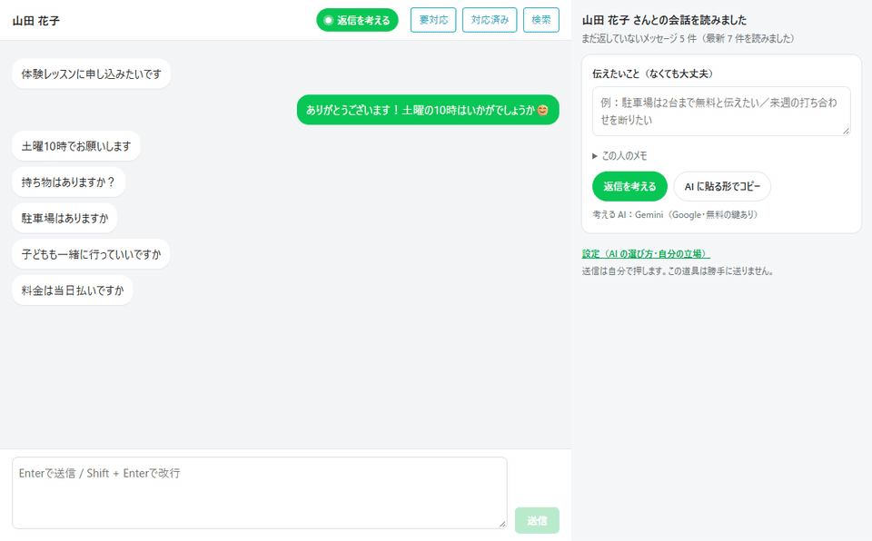
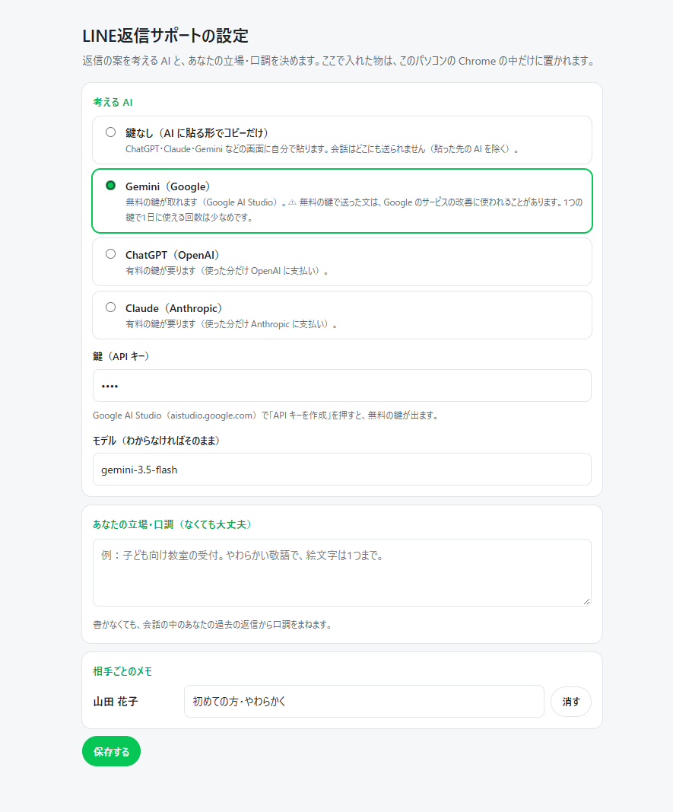

# 返信サポート by ずんだもんAI

**LINE 公式アカウントの管理画面（chat.line.biz）で使える、返信の案づくりの道具です。**

LINE 公式アカウントの管理画面（chat.line.biz）で、**返したいときにボタンを押すと、それまでの会話をまるごと読み、まだ返していない相手のメッセージ（1通でも10通でも）に漏れなく応える返信の案**を作る Chrome の拡張機能です。

- 返信の案は入力欄に入れるところまで。**送信は自分で押します**（勝手に送りません）
- 無料で使えます。AI の鍵がなくても使えます

## できること

- **返すこと**：まだ返していない相手の発言から、答えるべき点（質問・お願い・お礼・知らせ）を箇条書きにします。たまっていても漏れが見えます
- **いちばん合う返信**と**別の言い方2つ**（短め・気持ちを込めて）
- これまでの会話の流れ（約束したこと・前に聞いたこと）と、**あなたの過去の返信の口調**に合わせます
- **未読だけコピー（AIに貼る）**：LINEでこちらがまだ読んでいない相手のメッセージだけを、AIへの頼み文と一緒にコピーできます。既読の過去の会話とこちらの返信は入りません。会話を開くと既読になるため、「まだ返していない会話」の一覧から人を選んで使います。未読がなければ、コピーの内容は変えずに知らせます
- 話し方を編集してから「返信を考える」「コピー」を押しても、編集中の内容が消えません。考えている途中で相手やタブが変わったら、前の相手の返信案を表示しません
- 分からない事実（日にち・金額・できるかどうか）は作らず、`［要確認：…］` と空けて目立たせます
- 「返さなくてもよい／スタンプで十分」な場面はそう言います
- 相手が送信を取り消したメッセージには触れません
- こちらが最後に送っているときは、相手が読んだかどうかを踏まえて、追いの一言が要るかを考えます
- 押す前に「伝えたいこと」をひとこと書けます（例：駐車場は2台まで無料と伝えたい）
- **相手によって話し方を変えられます**（例：母＝フランクに、お客さま＝丁寧な敬語）。全体の口調より、その人の話し方を優先します
- **同じ写真は二度と保存しません**：「写真も保存」を押すと、写真の中身を見分けて、保存済みの写真は飛ばします（同じ写真が別のメッセージで届いても・前に別の名前で保存していても・ダウンロードの履歴にあれば）。名前は「届いた日時＋写真の中身から決まる記号」で、同じ写真はいつも同じ名前です
- **横の窓は、LINE の管理画面のタブにだけ出ます**：ほかのタブにはついて回りません。開くのは、拡張機能のアイコンか「返信を考える」ボタンを押したときだけです
- **会話を開かずに読めます**：横の窓の「まだ返していない会話」から人を選ぶと、相手に既読を付けずに返信の案を作れます。送るときだけ会話を開きます

## 2つの使い方

| | 使い方 | 向いている人 |
| :-- | :-- | :-- |
| **鍵なし** | 「AI に貼る形でコピー」→ ChatGPT・Claude・Gemini や、Claude Code などのエージェントの AI に貼る → 出た返信を入力欄に貼る | まず試したい人・会話を特定の AI にだけ渡したい人 |
| **鍵あり** | 設定で AI の鍵を入れておくと、横の窓の中でボタン1つで案が出る（写真も、取り出せたときは AI に見せます。見せた枚数は窓に出ます） | 毎日たくさん返す人 |

鍵ありで選べる AI：Gemini（Google・**無料の鍵が取れます**）／ChatGPT（OpenAI・有料）／Claude（Anthropic・有料）。鍵ありでも、コピーはいつでも使えます。

## 入れ方

1. [いちばん新しい版](https://github.com/tashirosmasashis-cell/line-reply-helper/releases/latest)のページで、「Assets」の中の `reply-helper-<版>.zip` を落とし、好きな場所に展開します
2. Chrome で `chrome://extensions` を開き、右上の「デベロッパーモード」をオンにします
3. 「パッケージ化されていない拡張機能を読み込む」を押し、展開したフォルダ（`manifest.json` がある所）を選びます
4. LINE 公式アカウントの管理画面（chat.line.biz）を開き直すと、会話の上（相手の名前の右、「要対応」などの並び）に緑の「返信を考える」ボタンが出ます

新しい版が出ると、横の窓に「新しい版があります」と出ます。そのときは同じ手順で入れ直してください。

## 使い方

1. 管理画面で相手との会話を開き、上の「返信を考える」を押します（右に窓が開きます）
2. 伝えたいことがあれば書きます（なくても大丈夫）
3. 「返信を考える」（鍵あり）か「AI に貼る形でコピー」（鍵なし）を押します
4. 案を読んで直し、「入力欄に入れる」→ 管理画面で読み直してから、**送信は自分で押します**

## 設定（AI の選び方）

窓の下の「設定」から開きます。

- **Gemini の無料の鍵**：[Google AI Studio](https://aistudio.google.com/) で「API キーを作成」を押すと出ます。1つの鍵で1日に使える回数は少なめです
- ⚠ **無料の Gemini の鍵で送った文は、Google のサービスの改善に使われることがあります**。仕事の会話を渡したくないときは、有料の AI か、鍵なしのコピーを選んでください

## どこに何が送られるか

- 会話は、**あなたが選んだ AI にだけ**送られます（鍵なしなら、どこにも送りません。貼った先の AI を除く）
- 鍵・メモ・設定は、このパソコンの Chrome の中だけに置きます
- 1日1回、この GitHub に「新しい版の番号」だけを聞きに行きます（会話は送りません）
- 会話の中の**パスワードらしき所は伏せてから**AI に渡します（「パス ○○」「パスワード：○○」など）
- **メールアドレスと電話番号も伏せてから**渡します（設定で外せます）

## 安全のための作り

- 勝手に送信しません。入力欄に入れるだけです
- 案を作ったあとに別の会話を開いていたら、入力欄に入れません（別の人に送る事故を防ぐため）
- 使える許可は、LINE の管理画面・写真の取得・選んだ AI の住所・設定の保存・横の窓・写真の保存だけです

## 対応していないもの

- スマホの LINE 公式アカウントのアプリ、個人の LINE（パソコン版のアプリ・Chrome 版の LINE）
- グループの会話（1対1の会話だけです）

## ご注意

- **LINE の非公式の道具です**。LINE ヤフー株式会社とは関係ありません。管理画面が自分で使っている内部の仕組みを読んでいるので、管理画面が変わると読めなくなることがあります。そのときは「会話を読めませんでした」と出ます。直した版を出すまでお待ちください
- 作者名の「ずんだもんAI」はハンドルネームです。東北ずん子・ずんだもんプロジェクトの公式の道具ではなく、関係もありません。
- 自分のアカウントの画面を読むだけで、外へは選んだ AI 以外に何も送りません。使うかどうかはご自身の判断でお願いします
- ChatGPT・Claude の鍵での動きは、作者は実物では確かめていません（作り物の答えでの試験のみ）。うまくいかなければ Issues で教えてください

## 開発する人へ

- ビルドは要りません。素の JavaScript（Manifest V3）です
- 試験：`node test/run.mjs`（会話は全部架空です）
- 管理画面の読み取り方は `src/lib/linechat.js` に1か所にまとめてあります。管理画面が変わったら、ここを直します

## 作った人

ずんだもんAI（高槻市の AI エンジニア）

- サイト（実績・デモ・ブログ）：https://zunda.tsutsumicommunity.org
- この道具を作った話（ブログ）：https://zunda.tsutsumicommunity.org/blog/line-reply-helper/
- GitHub：https://github.com/tashirosmasashis-cell

業務の仕組みづくりのご相談は、サイトの「事業者の方へ」からどうぞ。

## ライセンス

MIT
